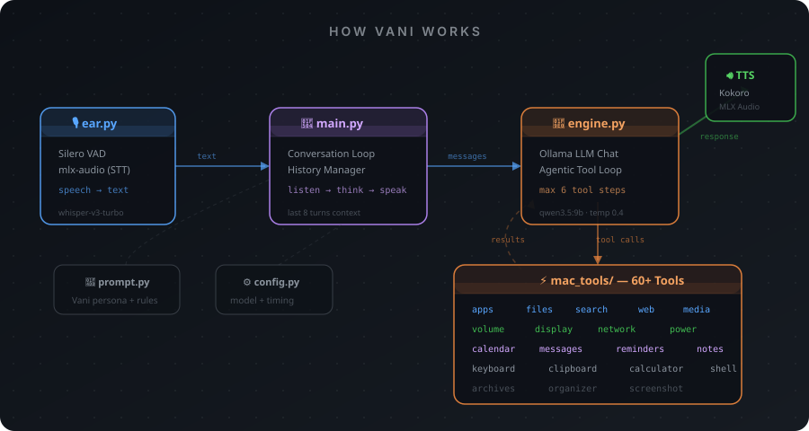

# Architecture

Vani runs a continuous **wake → listen → think → act → speak** loop completely on-device on Apple Silicon.

  

## Pipeline Flow

1. **Wake Word (`vani.audio.wake`, `vani.audio.listener`)**
   - `WakeWordDetector` listens passively on 80 ms (`1280`-sample, 16 kHz) audio frames using `openwakeword` (`onnxruntime`).
   - Silero VAD and MLX Whisper stay idle until the wake word fires.
2. **Speech-to-Text (`vani.audio.listener`)**
   - Once awake (or during the `FOLLOW_UP_SECONDS` conversational window), `SileroVAD` processes 32 ms (`512`-sample) chunks with a 15-frame (~0.5 s) pre-speech ring buffer.
   - After `WAIT_TIME_SECONDS` (`1.5` s) of trailing silence, audio is transcribed via `mlx-audio` (`mlx-community/whisper-large-v3-turbo-asr-fp16`).
3. **Agent & History (`vani.app`, `vani.agent`)**
   - `vani.app.main()` manages the conversation loop, exit checks, and error rollback checkpoints.
   - `vani.agent.history.trim_history()` keeps the system prompt plus the last `keep_turns` (`8`) user turns without splitting tool calls from their tool results.
   - `vani.agent.engine.process_prompt()` calls Ollama (`MAIN_MODEL`) with all registered tools in a loop of up to `MAX_STEPS` (`6`) steps.
4. **macOS Tools (`vani.tools`)**
   - `vani.tools.__init__` discovers all tool modules recursively with `pkgutil.walk_packages`.
   - Tools execute OS actions through the `CommandRunner` abstraction in `vani.tools.core.runner` rather than calling `subprocess` directly.
5. **Text-to-Speech (`vani.audio.speaker`)**
   - Synthesizes speech via `mlx-audio` (`TTS_MODEL`, `TTS_VOICE`, `TTS_LANG_CODE`, `TTS_SPEED`) to a temporary WAV file created with `tempfile` and plays it via `afplay` (cleaning up the temp file afterward).
   - `vani.audio.speaker_fallback` provides a fallback using native macOS `say`.

## Package Layout

| Component | Module | Responsibility |
| --- | --- | --- |
| Entrypoint | `src/vani/app.py` | Main state loop, quit keyword guards, history checkpoints |
| CLI wrapper | `src/vani/__main__.py` | Enables `python -m vani` |
| Config | `src/vani/config.py` | LLM, VAD, wake-word, and TTS settings |
| Agent Engine | `src/vani/agent/engine.py` | Ollama chat + multi-step tool execution loop |
| System Prompt | `src/vani/agent/prompt.py` | Vani persona, speech rules, and current date/time context |
| History | `src/vani/agent/history.py` | `trim_history()` keeping tool call/result pairs intact |
| Wake Word | `src/vani/audio/wake.py` | `WakeWordDetector` wrapping `openwakeword` |
| Listener | `src/vani/audio/listener.py` | Mic stream, wake gate, Silero VAD, and MLX Whisper STT |
| Speaker | `src/vani/audio/speaker.py` | MLX Audio Kokoro TTS with temporary WAV playback |
| Fallback Speaker | `src/vani/audio/speaker_fallback.py` | Native macOS `say` fallback |
| Tool Registry & Core | `src/vani/tools/core/` | `@tool` decorator, `CommandRunner`, paths, dates, safety |
| Tool Modules | `src/vani/tools/{system,files,comms,media,desktop,utility}/`, `advanced.py` | 71 macOS automation tools |
