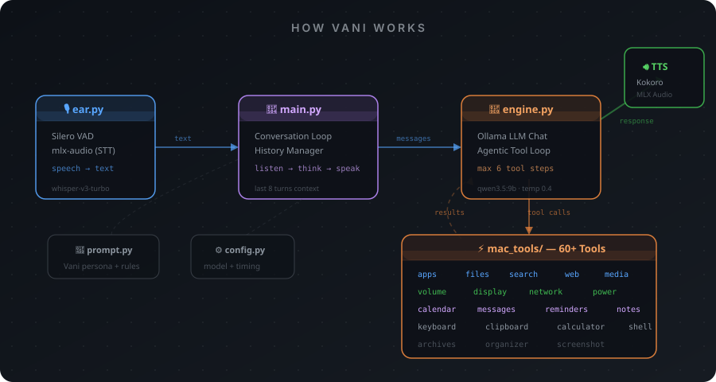

<p align="center">
  
</p>

<h1 align="center"></h1>

<p align="center"><b>Your personal voice assistant, running entirely on your Mac.</b></p>

<br>

<p align="center">
  <b>Fully local voice assistant for macOS.</b> Speech-to-text, LLM reasoning, 60+ macOS tools, and neural text-to-speech.<br>
  Built on MLX, Ollama, and Apple Silicon.
</p>

<p align="center">
  <a href="#features">Features</a> ·
  <a href="#installation">Installation</a> ·
  <a href="#quick-start">Quick Start</a> ·
  <a href="#architecture">Architecture</a> ·
  <a href="#available-tools">Available Tools</a>
</p>

<p align="center">
  
  
  
  
  
  
</p>

---

## Table of Contents

- [Features](#features)
- [Installation](#installation)
- [Quick Start](#quick-start)
- [Architecture](#architecture)
- [Available Tools](#available-tools)
- [Adding a New Tool](#adding-a-new-tool)
- [Configuration](#configuration)
- [Safety](#safety)
- [Testing](#testing)
- [Requirements](#requirements)
- [Acknowledgements](#acknowledgements)

## Features

- Fully local and private — no API keys, no cloud, all inference on-device
- Continuous voice interaction with Silero VAD (voice activity detection)
- Speech-to-text via MLX Whisper (`whisper-large-v3-turbo`) on Apple Silicon
- Neural text-to-speech via Kokoro (`Kokoro-82M-bf16`) on Apple Silicon
- LLM reasoning with Ollama (`qwen3.5:9b`) and agentic multi-step tool calling
- 60+ macOS control tools — apps, files, web, media, system, messaging, calendar, and more
- Vani persona — calm, sharp, and quietly witty
- Extensible plugin architecture — drop a file in `mac_tools/` and it's auto-discovered
- Safety-first design with path protection, shell blocklist, and confirmation gates
- Conversation memory with automatic context trimming (last 8 turns)

## Installation

### Prerequisites

- macOS on Apple Silicon (M1/M2/M3/M4)
- Python 3.13+
- [Ollama](https://ollama.com) installed and running

### Pull the LLM model

```bash
ollama pull qwen3.5:9b
```

### Using pip

```bash
git clone <your-repo-url>
cd "Voice Assistant"
```

Create a virtual environment and install dependencies:

```bash
python -m venv myenv
source myenv/bin/activate
pip install -r requirements.txt
pip install silero-vad-lite
```

### Grant macOS permissions

Go to **System Settings → Privacy & Security** and grant your terminal the following:

- **Microphone** — for voice input
- **Accessibility** — for keyboard control and app management
- **Automation** — for AppleScript-based tools (Calendar, Music, Reminders, etc.)

## Quick Start

### Running the assistant

```bash
python main.py
```

The assistant will load the VAD, Whisper, and Kokoro models into memory (first run downloads the models automatically), then begin listening for your voice.

### Example commands

```
"Hey, what's the weather like today?"

"Open Google Chrome and search for MLX Audio"

"Set a timer for 5 minutes"

"What's my battery percentage?"

"Send an iMessage to John saying I'll be there in 10"

"Create a calendar event for tomorrow at 3pm called Team Standup"

"Organize my Downloads folder"

"Turn on dark mode and set the volume to 50"
```

### Exiting

Say **"exit"**, **"quit"**, or **"stop"** to shut down the assistant.

## Architecture

The system follows a **listen → think → act → speak** loop:

<p align="center">
  
</p>

### Component overview

| Component | File | Description |
| --- | --- | --- |
| Entry Point | `main.py` | Main listen → think → speak loop. Manages conversation history and exit logic. |
| LLM Engine | `engine.py` | Sends messages to Ollama with tool definitions. Runs an agentic loop (max 6 steps) executing tool calls until a final text response is produced. |
| Speech-to-Text | `tools/ear.py` | Captures audio via microphone, detects speech with Silero VAD, transcribes with MLX Whisper (`whisper-large-v3-turbo`). Uses a ring buffer to avoid clipping. |
| Text-to-Speech | `tools/voice.py` | Synthesizes speech with Kokoro (`Kokoro-82M-bf16`) via MLX Audio. Strips markdown before synthesis. |
| TTS Fallback | `tools/voice2.py` | Fallback TTS using the native macOS `say` command. |
| System Prompt | `prompt.py` | Vani persona definition with dynamic date/time, speech-optimized output rules, and safety guidelines. |
| Tool Registry | `mac_tools/core/registry.py` | `@tool` decorator and `ToolRegistry` class powering auto-discovery. |
| Tool Runner | `mac_tools/core/runner.py` | `CommandRunner` abstraction over subprocess, enabling testable tool implementations. |
| macOS Tools | `mac_tools/*.py` | 60+ tool functions across 17 modules. |

### Project structure

```
Voice Assistant/
├── main.py                  # Entry point
├── engine.py                # LLM tool-calling loop
├── prompt.py                # Vani system prompt
├── config.py                # Model & timing configuration
├── requirements.txt         # Python dependencies
├── tools/
│   ├── ear.py               # Speech-to-text (VAD + Whisper)
│   ├── voice.py             # Text-to-speech (Kokoro)
│   ├── voice2.py            # TTS fallback (macOS say)
│   └── sys_tools.py         # Exit signal tool
├── mac_tools/
│   ├── __init__.py           # Auto-discovers all tool modules
│   ├── core/
│   │   ├── registry.py       # @tool decorator & registry
│   │   ├── runner.py         # CommandRunner abstraction
│   │   ├── applescript.py    # AppleScript helpers
│   │   ├── app_resolver.py   # Fuzzy app name resolution
│   │   ├── paths.py          # Path resolution & safety
│   │   ├── results.py        # Standardized result strings
│   │   ├── dates.py          # Date parsing utilities
│   │   └── safety.py         # Shell command blocklist
│   ├── apps.py               # App management
│   ├── files.py              # File operations
│   ├── file_search.py        # File search (Spotlight)
│   ├── web.py                # Web & search
│   ├── media.py              # Music & media control
│   ├── sound_display.py      # Volume, brightness, dark mode
│   ├── system_info.py        # Battery, disk, system info
│   ├── network.py            # Wi-Fi, Bluetooth, IP
│   ├── power.py              # Lock, sleep, restart, shutdown
│   ├── input_control.py      # Keyboard input
│   ├── messaging.py          # iMessage, email
│   ├── calendar_tools.py     # Calendar events
│   ├── reminders_notes.py    # Reminders & notes
│   ├── calculator.py         # Safe math eval
│   ├── desktop_utils.py      # Clipboard, notifications, screenshots
│   ├── organizer.py          # Folder organizer
│   ├── archives.py           # Zip & unzip
│   ├── advanced.py           # Raw shell & AppleScript
│   └── tests/
│       └── test_tools.py     # Unit tests with FakeRunner
```

## Available Tools

### Apps
`open_app` · `quit_app` · `force_quit_app` · `list_running_apps` · `get_frontmost_app` · `open_system_settings`

### Files
`list_directory` · `get_file_info` · `read_text_file` · `write_text_file` · `append_text_file` · `create_folder` · `move_path` · `copy_path` · `rename_path` · `delete_path` · `empty_trash`

### File Search
`find_files` · `search_in_files` · `open_path` · `open_file_with_app` · `reveal_in_finder`

### Web
`open_url` · `web_search` · `play_on_youtube` · `get_weather`

### Media
`music_control` · `get_now_playing` · `play_song_in_music`

### Sound & Display
`get_volume` · `set_volume` · `change_volume` · `set_mute` · `change_brightness` · `set_dark_mode` · `toggle_dark_mode`

### System Info
`get_battery_status` · `get_system_info` · `get_disk_usage` · `get_current_datetime`

### Network
`set_wifi` · `set_bluetooth` · `get_ip_address`

### Power
`lock_screen` · `sleep_display` · `sleep_mac` · `restart_mac` · `shut_down_mac`

### Input Control
`type_text` · `press_keys`

### Messaging
`send_imessage` · `compose_email`

### Calendar
`create_calendar_event` · `get_calendar_events`

### Reminders & Notes
`create_reminder` · `list_reminders` · `create_note`

### Calculator
`calculate`

### Desktop Utilities
`get_clipboard` · `set_clipboard` · `show_notification` · `speak` · `take_screenshot` · `set_timer`

### Organizer
`organize_folder`

### Archives
`zip_path` · `unzip_file`

### Advanced
`run_shell_command` · `run_applescript`

## Adding a New Tool

Create a new `.py` file in `mac_tools/` (or add to an existing one) and use the `@tool` decorator:

```python
from mac_tools.core import tool, CommandRunner

@tool(
    category="my_category",
    confirm=False,  # Set True for destructive actions
)
def my_new_tool(runner: CommandRunner, name: str, count: int = 5) -> str:
    """Short description for the LLM to understand what this tool does.

    Args:
        name: What this argument is for.
        count: Optional argument with a default value.
    """
    result = runner.run(["echo", name])
    return f"Done: {result.stdout}"
```

The tool is automatically discovered and available to the LLM on the next run. No registration code needed.

## Configuration

Edit `config.py` to customize:

```python
MAIN_MODEL = 'qwen3.5:9b'     # Ollama model name
WAIT_TIME_SECONDS = 2.5        # Silence duration (seconds) before speech is transcribed
```

## Safety

- **Path protection** — system directories and top-level home folders (Desktop, Documents, etc.) cannot be deleted
- **Shell blocklist** — dangerous commands like `sudo`, `rm -rf /`, `mkfs`, `dd`, and curl-pipe-to-shell patterns are blocked
- **Confirmation gates** — destructive actions (delete, empty trash, restart, shutdown, send messages) require explicit user confirmation before execution
- **Tool loop limit** — max 6 tool calls per turn to prevent infinite loops
- **False exit prevention** — LLM exit signals are validated against actual keywords in the user's speech
- **Safe math** — calculator uses AST parsing instead of `eval()` to prevent code injection

## Testing

Run the unit tests (cross-platform — no macOS required thanks to the `FakeRunner` abstraction):

```bash
python -m pytest mac_tools/tests/
```

Tests cover tool registration, category filtering, app resolution, confirmation requirements, shell blocklist enforcement, calculator safety, file operations, and organizer logic.

## Requirements

| Package | Purpose |
| --- | --- |
| `ollama` | Local LLM inference client |
| `mlx-audio` | Whisper STT & Kokoro TTS on Apple Silicon |
| `sounddevice` | Microphone audio capture |
| `soundfile` | WAV file I/O |
| `numpy` | Audio array processing |
| `misaki` | Phonemizer for Kokoro TTS |
| `num2words` | Number-to-word conversion for TTS |
| `silero-vad-lite` | Voice activity detection |
| `loguru` | Logging |

## Acknowledgements

- [Ollama](https://ollama.com) — local LLM inference
- [MLX](https://github.com/ml-explore/mlx) — Apple Silicon ML framework
- [MLX Audio](https://github.com/Blaizzy/mlx-audio) — Whisper & Kokoro on MLX
- [Silero VAD](https://github.com/snakers4/silero-vad) — voice activity detection
- [Kokoro](https://huggingface.co/hexgrad/Kokoro-82M) — neural text-to-speech

---

<p align="center">Built with ❤️ on Apple Silicon</p>
